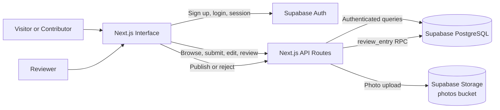
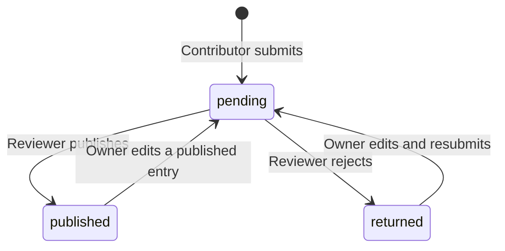

# Khmer Living Archive — Cambodian Living Foods

## 1. About the Cambodian Village Foods Archive

Cambodian Village Foods is a digital living archive created to document and preserve traditional Cambodian foods and the cultural stories connected to different villages and local communities. The collection is built from interviews with local people who share their knowledge, experiences, and stories about traditional foods and food practices. Each entry documents information about the food, its cultural background, its associated location, and the person or source who contributed the information. The archive allows visitors to browse and search published entries, explore Cambodia's local food heritage, and contribute their own knowledge and stories. All new contributions are submitted for review before publication to help maintain the quality and reliability of the collection.

## 2. Target Users and Accessibility
### Our Target Audience
Cambodian Village Foods is designed for Cambodian people and international visitors who are interested in exploring and learning about traditional Cambodian food and cultural heritage. It provides a platform for local communities to share their food knowledge and stories while allowing younger generations, students, researchers, and visitors to discover traditional Cambodian dishes and their cultural backgrounds.

### Language 
  - English
  - Khmer

### Mobile Accessibility
  - Responsive page layouts.
  - Mobile-friendly browsing.
  - Accessible contribution and review interfaces.
    

### Low-Bandwidth Considerations
To support users with slower internet connections, the archive uses compressed and resized food images to reduce unnecessary data transfer. 

###  Sources and Contributor Attribution
The archive recognizes the people and communities who contribute traditional food knowledge through interviews. Each entry includes relevant contributor information and the associated village or location to provide context about where the information originated. 

### Contributor Privacy
The archive respects contributors who prefer to keep their identities private. With their permission, anonymous descriptions can be used instead of publishing their personal names. 

## 3. System Architecture and How It Works

### 3.1 System Architecture

Cambodian Village Foods uses Next.js for the frontend and Vercel for website hosting and deployment. Supabase provides the backend services, including user authentication, PostgreSQL database management, server-side session handling, and image storage. The frontend communicates with Supabase to manage user accounts, retrieve food entries, submit contributions, edit owned entries, and access stored photographs.

| Component | Technology | Responsibility |
|---|---|---|
| Frontend | Next.js 15 and React 19 | Provides the website interface, archive browsing, search and filtering, account pages, contribution forms, entry details, editing, and review interface |
| Hosting | Vercel | Builds and serves the Next.js application |
| Authentication | Supabase Auth | Registers users, verifies passwords, creates sessions, and identifies the signed-in owner |
| Database | Supabase PostgreSQL | Stores food entries, Khmer and English titles, descriptions, locations, contributor names, owners, photographs, and publication status |
| Image storage | Supabase Storage | Stores food photographs in the public `photos` bucket |
| Database security | Row Level Security (RLS) | Restricts database access according to ownership and reviewer role |
| API layer | Next.js Route Handlers | Performs authentication checks, server-side validation, database reads, photo uploads, and review decisions |



### 3.2 How the System Works

The archive supports three main user roles: visitors, contributors, and reviewers.

- **Visitors** browse and search published food entries without logging in.
- **Contributors** create an account or log in, submit food entries, and manage their own contributions.
- **Reviewers** access the review queue, inspect submitted entries, and publish or return contributions.

The main contribution workflow is:

1. A contributor creates an account or logs in.
2. The contributor submits a food entry and photograph through the website.
3. The application validates the submission and stores it in Supabase with `pending` status.
4. A reviewer opens the review queue and checks the submitted information.
5. The reviewer publishes the entry or returns it to the contributor for revision.
6. Published entries become available in the public archive.

#### Accounts and sessions

Users register or sign in through Supabase Auth. Browser and server clients use Supabase SSR authentication cookies. Protected Next.js Route Handlers call `supabase.auth.getUser()` to verify the active session rather than trusting a user identifier supplied by the browser.

#### Browsing and submitting

The public home page requests `GET /api/entries`. The API returns only rows with `status = "published"`. Visitors can search English and Khmer titles, descriptions, contributor names, and places, and filter entries by location.

A signed-in contributor submits English and Khmer titles, a story, place, optional contributor name, and a required photograph through `POST /api/entries`. The server validates the fields and photograph, verifies the active user, creates a randomized storage path under the user's ID, and inserts the entry with the authenticated user's ID as `owner`. The database must assign `pending` as the new-entry default status; the application also expects this status for subsequent review processing.

Entry edits are submitted from the browser through Supabase's authenticated client. The edit page updates only rows owned by the signed-in user and sets the entry back to `pending` for re-review.



### 3.3 Database Structure

Supabase PostgreSQL stores the archive data. The application's entry queries use an `entries` table containing the following important data categories:

| Data category | Purpose |
|---|---|
| Entry content | English title, Khmer title, English description, optional Khmer description, and place |
| Attribution | Optional contributor name |
| Photograph | Public URL for the stored food photograph |
| Ownership | Authenticated owner's user ID |
| Review state | `pending`, `published`, or `returned` status |

The exact table columns and relationships must be configured consistently with the application's queries. The repository provides the `supabase/review_entry.sql` setup for authorized review decisions.

The optional Khmer description (`description_kh`) is added by `supabase/add_description_kh.sql`. That file must be run in the Supabase SQL editor before deploying code that writes the column. The column is nullable: when it is empty or null, the food cards and the food detail page fall back to the English description, so entries created before the migration keep working unchanged. The Khmer description is optional in both the contribution form and the edit form, is capped at the same 3000 characters as the English description, and is included in the home-page search. This field is not covered by automated tests because the repository has no test framework; it was validated with `npm run build` and manual checks of the forms and the detail page.

The database functions used by the application are:

| Function | Purpose |
|---|---|
| `is_reviewer()` | Checks whether the authenticated user has reviewer authorization |
| `review_entry(entry_id, decision)` | Publishes or returns an entry as an authorized reviewer |

The `review_entry.sql` file must be run in the Supabase SQL editor. It also prevents unauthorized decisions and rejects review decisions that would violate the entry status constraint.

### 3.4 Entry Status Workflow

| Status | Description |
|---|---|
| `pending` | A newly submitted entry waiting for reviewer approval |
| `published` | An approved entry available to public visitors |
| `returned` | An entry sent back to its contributor for revision |

When a reviewer rejects an entry, the database stores it as `returned` so the contributor can revise it. Editing a returned or pending entry resubmits it as `pending`. Editing a published entry also changes it back to `pending`, so it must be reviewed again before becoming public.

### 3.5 Authentication and Authorization

Supabase Auth manages user registration, login, and sessions. Authentication confirms who a user is, while authorization determines which actions the user may perform.

- Visitors can browse published entries.
- Contributors can submit entries and view or manage entries they own.
- Reviewers can access the pending-review queue and perform authorized publish or return decisions.
- Route Handlers verify authentication and reviewer access before protected operations.
- Database policies remain the final backstop for ownership and reviewer restrictions.

### 3.6 Row Level Security (RLS) Policies

Row Level Security controls which database records users can read, create, update, or delete. RLS must be enabled and configured in Supabase for the `entries` table and relevant database objects.

The intended access rules are:

- Public visitors can read only published entries.
- Contributors can access and manage their own entries according to owner policies.
- Reviewers can access pending entries and make authorized review decisions.
- Unauthorized users cannot publish entries or call reviewer operations.
- A contributor cannot set a new entry directly to `published`.

The application includes checks in its API and database functions, but RLS and Storage policies must also be configured in Supabase to enforce these restrictions at the database level. The repository does not contain the complete schema or RLS migration; the deployed `entries` RLS configuration was reviewed in the Supabase dashboard, as described in Section 5.

## 4. Security Decisions

Security is important for the Cambodian Village Foods archive because contributors must not be able to publish their own entries or access restricted reviewer operations. The application uses Supabase Authentication, Row Level Security (RLS), server-side validation, and PostgreSQL database functions to enforce permissions.

### 4.1 Why `review_entry()` Lives in the Database

The `review_entry()` PostgreSQL function is the database gate for publishing or returning entries. The review route calls it through Supabase RPC with the entry ID and the UI's decision:

```javascript
const result = await supabase.rpc("review_entry", {
  entry_id: id,
  decision: "published", // or "rejected"
});
```

The `supabase/review_entry.sql` implementation verifies that the current user passes `is_reviewer()`. It accepts only `published` or `rejected` decisions and updates a row only when its current status is `pending`.

If the caller is not an authorized reviewer, `review_entry()` returns `false`. If the entry is missing or is no longer pending, the update affects no row and the function also returns `false`. Invalid decision names raise an error instead of changing the entry.

The SQL file requires `is_reviewer()` to already exist in the deployed Supabase database. `is_reviewer()` is responsible for determining reviewer authorization, but it is not created by `review_entry.sql`.

Publishing or returning in the database prevents a user from treating a hidden review button as the only security control. A database client could call the RPC directly, so authorization must be checked by the database function rather than by the interface alone.

### 4.2 Why Hiding the Publish Button Is Not Enough

The review page can only present the review interface meaningfully to authorized users, and the review Route Handler independently checks:

- that the user is signed in;
- that `is_reviewer()` returns `true`;
- that the requested UI action is valid; and
- that `review_entry()` returns `true`.

These application checks improve the user experience, but hiding the button does not secure the data. The database function independently checks reviewer status and the current `pending` status before changing a row.

The route reports an error if the RPC itself fails or if `review_entry()` returns `false`. It also performs a follow-up status read when RLS allows the updated row to be read. A mismatched readable status is reported as a conflict. However, the route cannot confirm a stored status if RLS hides the row or the follow-up read fails, so the database function's `true` result remains the authoritative decision result in that case.

This provides two layers of protection:

- **Frontend and API:** control navigation and user-visible actions, validate requests, and return clear failures.
- **Database:** enforce reviewer authorization and restrict updates to pending entries.

### 4.3 Decision: What Happens When an Entry Is Returned?

When a reviewer rejects a pending entry, `review_entry()` stores the database status as `returned`. The route uses the UI decision name `reject`, sends `rejected` to the database function, and reports the resulting status as `returned`.

The contributor can view the returned entry in **My Entries** and edit it. The edit page sets the status back to `pending`, resubmitting the entry for review. The current workflow does not store a separate reviewer feedback field or written explanation.

### 4.4 Decision: Can Reviewers Unpublish Published Entries?

The current `review_entry()` function updates entries only when their status is `pending`. It publishes or returns pending entries and does not accept an action for changing a published entry back to `pending` or `returned`.

An owner editing a published entry can resubmit it as `pending`, but this is an owner edit and resubmission workflow, not a reviewer unpublish action. The current design therefore has no dedicated reviewer-controlled unpublish operation.

### 4.5 Decision: What Can Contributors See About Their Own Pending Entries?

Authenticated contributors can open **My Entries**, which requests all submissions owned by the authenticated user. The `/api/my-entries` route obtains the user ID from `supabase.auth.getUser()` and filters the database query by that session ID. It does not accept an owner ID from the request.

This owner-scoped endpoint allows contributors to track `pending`, `returned`, and `published` entries. The public `/api/entries` endpoint separately filters for `status = "published"`, so pending and returned entries do not appear in public browsing or search results.

RLS must also be enabled and configured for the deployed `entries` table to make ownership restrictions enforceable at the database level. Although the repository does not include the complete RLS policy migration, the deployed configuration was reviewed in the Supabase dashboard, as documented in Section 5. The application code's owner checks and public published-only query do not replace these database policies.

## 5. AI Use

AI tools assisted with implementation, debugging, code review, and documentation. Most development sessions used Cline for VS Code (version 4.1.26) with models provided through OpenRouter. The models and session counts below are from the local Cline session records. GitHub Copilot through the Copilot SDK in VS Code was also used for the README audit and revisions in this conversation.

| Model / tool | What it produced | What I kept, changed, or rejected |
|---|---|---|
| DeepSeek Flash (`~deepseek/deepseek-flash-latest`), through Cline / OpenRouter; 7 sessions, 27 Oct–18 Nov 2026 | Sprint 3 code review and fixes; review-queue PATCH and reject/return workflow; My Entries; sprint journal and README drafts; food-card and archive-logo work; UI review suggestions. | Used and revised, not accepted wholesale. The oversized featured card was replaced with equal-sized cards to keep the grid balanced. I removed an unnecessary two-line title gap, moved the logo into a shared component, and used a background-free PNG generated from the project JPG for the dark theme. Follow-up changes addressed Khmer letter spacing, filter-chip tap targets, and CSS color tokens. I also rewrote the README draft to correct its inaccurate AI-tool attribution and to distinguish verified behavior from unverified Supabase configuration. |
| DeepSeek V4 Flash (`deepseek/deepseek-v4-flash-0731`), through Cline / OpenRouter; 6 sessions, 29 Sep–3 Oct 2026 | Supabase-backed home-page browsing and search, English/Khmer switcher, contribution form with photo upload, and work on the `entries` schema. | Kept and adapted. The home page and search use `/api/entries`; the contribution form was adjusted to the project's session handling and validation rather than copied without review. |
| NVIDIA Nemotron 3 Nano Omni 30B A3B Reasoning (`nvidia/nemotron-3-nano-omni-30b-a3b-reasoning:free`), through Cline / OpenRouter; 9 sessions, 21 Sep–23 Oct 2026 | Signup/login debugging, work on `login-form.js`, Login/Sign Up header links, and fixes for build errors in `app/page.js`. | Partly kept. Some attempts did not solve the reported errors and the work continued in later sessions. The final auth implementation uses `createBrowserClient` from `@supabase/ssr`; the final result was checked against the project's code and build. |
| Google Gemma 4 31B IT (`google/gemma-4-31b-it:free`), through Cline / OpenRouter; 3 sessions, 21–25 Sep 2026 | Login-route 404 investigation and a draft PostgreSQL `CREATE TABLE` statement for `entries`. | The login investigation was followed by later work. The final fate of the SQL draft is unverified, so I do not claim that it was kept or that it defines the deployed schema. |
| NVIDIA Nemotron 3.5 Lightning (`nvidia/nemotron-3.5-lightning:free`), through Cline / OpenRouter; 4 sessions, 4–20 Sep 2026 | `data/entries.js` populated with the project's real food entries, search-bar UI work, and an initial Supabase client attempt. | The food-entry data and search-bar work were retained. The initial Supabase client attempt was cancelled and redone later; it was not treated as the final client implementation. |
| Qwen 3.8 27B (`qwen/qwen3.8-27b:free`), through Cline / OpenRouter; 2 sessions, 21 Sep 2026 | Login-route 404 investigation. | Not retained as the final fix; the issue was addressed in later work. |
| Anthropic Claude Sonnet 5 (`anthropic/claude-sonnet-5`), through Cline / OpenRouter; 1 session, 27 Aug 2026 | Read the project and summarized its purpose. | No code was produced. |
| GPT-6 Luna, through GitHub Copilot SDK in VS Code; this README-editing session | Audited and drafted README Sections 3–6 against the application routes, SQL, and available contribution records. | I reviewed and rewrote the drafts to correct unsupported claims, identify the unresolved Gemma SQL outcome, record the reported RLS review and workflow tests, and flag missing consent and photo-credit records rather than inventing them. |

Several project commits also mark AI-assisted work in their messages: `0e890ed`, `f9710b9`, `a4ca937`, `e89acbc`, `5f68bf3`, and `49fc8f2`.

### How I Checked the Work

- Read the relevant application routes, components, and SQL when reviewing the implementation and documentation claims.
- Ran `npm run build`; Next.js compiled successfully.
- Checked the development server: `/`, `/login`, `/signup`, `/my-entries`, and `/review` returned HTTP 200.
- Checked server-rendered HTML for the food-card structure, archive logo image, and Khmer labels without letter spacing.
- Checked the served stylesheet for CSS color tokens and filter-chip styles.

I completed the two-account access test with separate contributor accounts. The test passed: each account could access its own submissions, Contributor B could not see, open, edit, or delete Contributor A's unpublished entry, and public browsing showed published entries but not pending or returned entries.

I also tested the reviewer workflow. A non-reviewer could not access the review queue or perform a review action. An authorized reviewer could publish and return pending test entries, and the contributor could see a returned entry, edit it, and resubmit it with `pending` status.

I verified that the Supabase dashboard was open to the project used by the application, confirmed that RLS is enabled on `entries`, and reviewed the deployed policies for published-entry access, contributor ownership, and reviewer permissions. The account tests used normal user accounts, not a service-role key. This verification included reviewing the database policy configuration as well as testing the application workflows; it was not a separate direct database-client test that bypassed the application's API. AI output was used as a starting point and reviewed or revised; the table identifies work whose final adoption could not be verified rather than presenting it as confirmed.

## 6. Sources and Credits

The archive records food stories shared by family members, neighbors, village elders, and local cooks. The current sample entries identify contributors by relationship or group and include a village or district. These are the labels currently recorded in `data/entries.js`; they do not establish that each person agreed to be identified publicly. Confirm permission for each contributor and location before final publication. If someone prefers not to be named, replace the current label with an agreed anonymous description in the format “a [role] in [place] who asked not to be named.”

## 6. Sources and Credits

This archive uses information collected through interviews with contributors and photographs from external sources. Contributors and locations are credited with permission. Anonymous descriptions are used when someone prefers not to have their name published.

### 6.1 Food Story Sources

| Food Entry | Contributor / Source | Village / Location |
|---|---|---|
| Prahok Ang | Som Bunnary | Kandieng District, Pursat Province, Cambodia |
| Nom Krouk | My Grandmother | Praek Sdey Village, Pursat, Cambodia |
| Egg Cake | My Grandmother | Kandieng District, Pursat, Cambodia |
| Num Banh Chok | My Grandmother | Kandieng District, Pursat, Cambodia |
| Banh Chhev Khmer | My Grandmother and Neighbors | Kandieng District, Pursat, Cambodia |
| Samlor Machu Kreung | My Grandmother | Kandieng District, Pursat, Cambodia |
| Samlor Kor ko | Som Bunnary | Kandieng District, Pursat, Cambodia |
| Somlor Mchu Kon Trey | Som Bunnary | Kandieng District, Pursat, Cambodia |


### 6.2 Photograph Sources

Each photograph is credited to its respective source.

| Food Entry              | Image Source / Website                                                                                                                                                                                                                            |
| ----------------------- | ------------------------------------------------------------------------------------------------------------------------------------------------------------------------------------------------------------------------------------------------- |
| Prahok Ang (ប្រហុកអាំង) | [https://web.facebook.com/share/1CjV7vpiay/](https://web.facebook.com/share/1CjV7vpiay/)                                                                                                                                                          |
| Nom Krouk               | [https://pin.it/6UO0ylFWh](https://pin.it/6UO0ylFWh)                                                                                                                                                                                              |
| Egg Cake                | [https://kohsantepheap.tv/wp-content/uploads/2020/07/106676203_140916834313295_3508202542617351843_n.jpg](https://kohsantepheap.tv/wp-content/uploads/2020/07/106676203_140916834313295_3508202542617351843_n.jpg)                                |
| Num Banh Chok           | [https://www.cambodiaembassyuk.org/wp-content/uploads/2023/11/Num-Banh-Chok-Khmer.jpg](https://www.cambodiaembassyuk.org/wp-content/uploads/2023/11/Num-Banh-Chok-Khmer.jpg)                                                                      |
| Banh Chhev Khmer        | [https://cooking538.wordpress.com/wp-content/uploads/2016/05/t137551.jpg](https://cooking538.wordpress.com/wp-content/uploads/2016/05/t137551.jpg)                                                                                                |
| Samlor Machu Kreung     | [https://encrypted-tbn0.gstatic.com/images?q=tbn\:ANd9GcRxgZBZ1mdn3Ej43bdvCnnCuPc6WkePXYIzGLizPZ8BlfD9DJhCvAfE9N4&s=10](https://encrypted-tbn0.gstatic.com/images?q=tbn\:ANd9GcRxgZBZ1mdn3Ej43bdvCnnCuPc6WkePXYIzGLizPZ8BlfD9DJhCvAfE9N4\&s=10)   |
| Samlor Kor ko           | [https://encrypted-tbn0.gstatic.com/images?q=tbn\:ANd9GcTz0b55G_WRTYrRz-h975hlguKGoUrf1nZgNo9KHWnsiOkhOwm6tpv6MdFJ&s=10](https://encrypted-tbn0.gstatic.com/images?q=tbn\:ANd9GcTz0b55G_WRTYrRz-h975hlguKGoUrf1nZgNo9KHWnsiOkhOwm6tpv6MdFJ\&s=10) |
| Somlor Mchu Kon Trey    | [https://encrypted-tbn0.gstatic.com/images?q=tbn\:ANd9GcTsLdealJRV8EqekLuWVdHfcWInP9nka9iIASzCyFkKR-C1tCh8eSW3Q3M&s=10](https://encrypted-tbn0.gstatic.com/images?q=tbn\:ANd9GcTsLdealJRV8EqekLuWVdHfcWInP9nka9iIASzCyFkKR-C1tCh8eSW3Q3M\&s=10)   |


## 7. Running It Locally

### Requirements

- Node.js and npm
- Git
- A Supabase project configured for the application's database and storage

### Installation

Clone the repository:

```sh
git clone https://github.com/amarathorng/cambodian-village-foods.git
cd cambodian-village-foods
```

Install dependencies:

```sh
npm install
```

Create `.env.local` in the project root and set the variables used by the application:

```env
NEXT_PUBLIC_SUPABASE_URL=your-supabase-project-url
NEXT_PUBLIC_SUPABASE_PUBLISHABLE_KEY=your-supabase-publishable-key
```

The application reads these names in its Supabase clients. No `.env.example` is currently provided. The `scripts/seed-photos.mjs` utility also reads `SERVICE_ROLE` when it runs against Supabase; this is a secret key, is not required to run the application, and must never be exposed to client code or committed.

Start the development server:

```sh
npm run dev
```

Open [http://localhost:3000](http://localhost:3000). Use a Supabase publishable key for `NEXT_PUBLIC_SUPABASE_PUBLISHABLE_KEY`; never put a service-role key in a `NEXT_PUBLIC_` variable. The publishable key is intended for client use, but database access still depends on correctly configured RLS policies and permissions.

## 8. Submission Checklist

- Live URL loads logged out and shows published entries only: Yes, https://cambodian-village-foods.vercel.app/
- A non-reviewer cannot publish their own entry through the review API: [PATCH request from the contributor's browser console returned 403; direct Supabase status-update/RLS test and unchanged entry status not verified], tested 2026-11-20
- Logged out, the API returns nothing pending or returned: yes, tested on 2026-11-20
- Contributors can edit and delete only their own entries: Yes, tested 2026-11-20
- No secrets anywhere in the repo history: yes, checked with Gitleaks (working directory and Git history) on 20 November 2026.
- At least eight real entries, each with a credited source: Fully verified, 8 entries listed in Section 6 and source accuracy and publication permission need confirmation.
- Khmer renders on every screen a user meets, including the queue: Yes, Tested on 21-Nov-2026
- Works at phone width: Yes, tested on 21-Nov-2026
- No test entries, lorem ipsum or TODO comments in shipped pages: Yes
- No console errors on the main pages: Yes
- jesseorndorff is a collaborator on this repo: Yes
- Supabase project restored and awake on 21-Nov-2026, Yes
- Demo video link opens in a private window: Yes, https://drive.google.com/file/d/1w1sOueooFNG0zg0wUUZDdAX_cknfe5I7/view?usp=sharing
- Reflection pasted in the Canvas submission: Yes
- Posted in the Show Your Archive discussion: Not yet 
- Q&A slot booked for date and time, Waiting for approval from professor due i have account issue.
